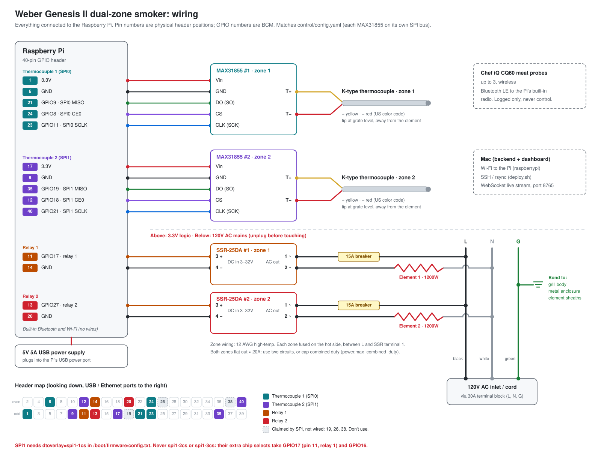

# Wiring: everything connected to the Pi



`wiring_diagram.png` is the same diagram as an image, for printing.

This matches `control/config.yaml`: each MAX31855 has its own SPI bus, so no
header pins are shared. Pin numbers are physical header positions; GPIO
numbers are BCM.

## Raspberry Pi header connections

| Pi pin | Function | Goes to | Wire |
|---|---|---|---|
| 1 | 3.3V | MAX31855 #1 Vin | power |
| 6 | GND | MAX31855 #1 GND | ground |
| 21 | GPIO9 · SPI0 MISO | MAX31855 #1 DO (may be labeled SO) | data |
| 24 | GPIO8 · SPI0 CE0 | MAX31855 #1 CS | chip select |
| 23 | GPIO11 · SPI0 SCLK | MAX31855 #1 CLK (may be labeled SCK) | clock |
| 17 | 3.3V | MAX31855 #2 Vin | power |
| 9 | GND | MAX31855 #2 GND | ground |
| 35 | GPIO19 · SPI1 MISO | MAX31855 #2 DO (SO) | data |
| 12 | GPIO18 · SPI1 CE0 | MAX31855 #2 CS | chip select |
| 40 | GPIO21 · SPI1 SCLK | MAX31855 #2 CLK (SCK) | clock |
| 11 | GPIO17 | SSR #1 terminal 3 (+) | relay 1 control |
| 14 | GND | SSR #1 terminal 4 (−) | ground |
| 13 | GPIO27 | SSR #2 terminal 3 (+) | relay 2 control |
| 20 | GND | SSR #2 terminal 4 (−) | ground |

**Claimed by SPI, not wired, don't use:** pin 19 (GPIO10, SPI0 MOSI), pin 26
(GPIO7, SPI0 CE1) and pin 38 (GPIO20, SPI1 MOSI). The MAX31855 has no data-in
line, so the MOSI pins stay empty, but the SPI drivers still own them.

`settings.py` refuses a relay pin on an SPI bus in use (SPI0: GPIO 7–11,
SPI1: GPIO 18–21).

## Thermocouples

| Zone | MAX31855 | Thermocouple | Placement |
|---|---|---|---|
| 1 | #1, SPI0, `/dev/spidev0.0` | K-type, T+ yellow, T− red | grate level near element 1, out of direct radiant heat |
| 2 | #2, SPI1, `/dev/spidev1.0` | K-type, T+ yellow, T− red | grate level near element 2, out of direct radiant heat |

Yellow + and red − is the US (ANSI) color code. If a reading falls when you
warm the probe, the two leads are swapped.

## Relays and 120V AC

SSR terminals (DMWD SSR-25DA): **1 ~ and 2 ~** are the AC switch, **3 +
and 4 −** the DC control input (3–32V).

Each zone, on its own circuit through the terminal block:

```
L (hot, black) ── breaker ── SSR terminal 1 ~ ┐
                                               SSR switch
              N (neutral, white) ── element ── SSR terminal 2 ~ ┘
G (ground, green) ── grill body, metal enclosure, element sheaths
```

- Fuse or breaker on the hot side only, between L and SSR terminal 1. Never
  switch or fuse the neutral.
- 12 AWG high-temp wire from the terminal block through to the elements.
- Bond ground to the grill body and to the stainless enclosure. The enclosure
  is metal, so it must be grounded.
- Mount each SSR on its heat sink with thermal paste. At ~10A continuous a
  25A SSR still gets hot.

### Check the breaker rating

The parts list has a 30A breaker from a car-audio listing. For this circuit
the breaker must be **rated for 120V AC**; many car-audio breakers are rated
for DC only. It should also be **15A per zone**. A 30A breaker won't trip
before 12 AWG wire (rated 20A) overheats, and each element draws about 10A.

### Power budget

Each 1200W element draws about 10A at 120V, so both zones flat out draw about
20A. That is more than one 20A circuit should carry continuously (about 16A).
Either feed each zone from its own circuit, or cap combined duty with
`power.max_combined_duty: 1.6` in `control/config.yaml`.

## Pi power, Bluetooth and network

| What | Connection |
|---|---|
| Pi power | 5V 5A USB supply into the Pi's USB power port. Keep it separate from the AC zone wiring. |
| Chef iQ CQ60 probes (up to 3) | Bluetooth LE to the Pi's built-in radio. Logged only, never used for control. |
| Mac | Wi-Fi to the Pi (address in `pi.env`, `raspberrypi` by default): SSH and rsync (`deploy.sh`), live WebSocket on port 8765. |

## Turning on the SPI buses

SPI0: `sudo raspi-config nonint do_spi 0` (adds `dtparam=spi=on`).

SPI1: add `dtoverlay=spi1-1cs` to `/boot/firmware/config.txt`
(`/boot/config.txt` before Bookworm), then reboot.

**Use `spi1-1cs`, never `spi1-2cs` or `spi1-3cs`.** Their extra chip selects
are GPIO17 (pin 11, relay 1) and GPIO16, so they would hand relay 1's pin to
the SPI driver.

After rebooting, `ls /dev/spidev*` should list `spidev0.0` and `spidev1.0`.
Then run `preflight.py`.

## Before powering up

1. Elements unplugged. Run `preflight.py`: SPI, both thermocouples at room
   temperature, relays off.
2. Run `ssr_test.py` with the elements still unplugged. Each SSR's LED should
   light in turn.
3. Only then connect the elements, and test with the grill lid open and
   someone watching.
